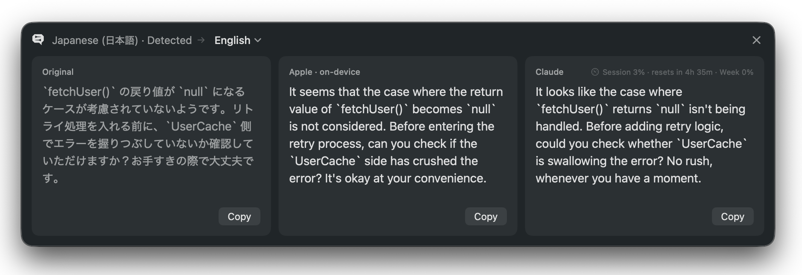
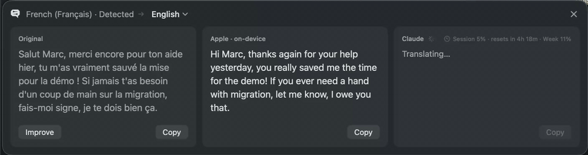
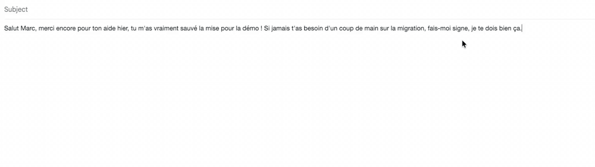
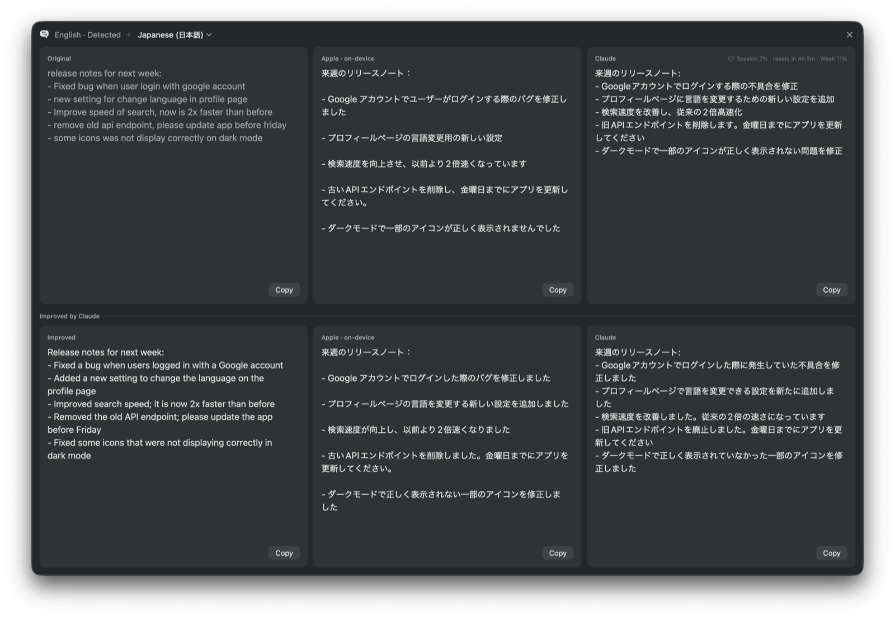
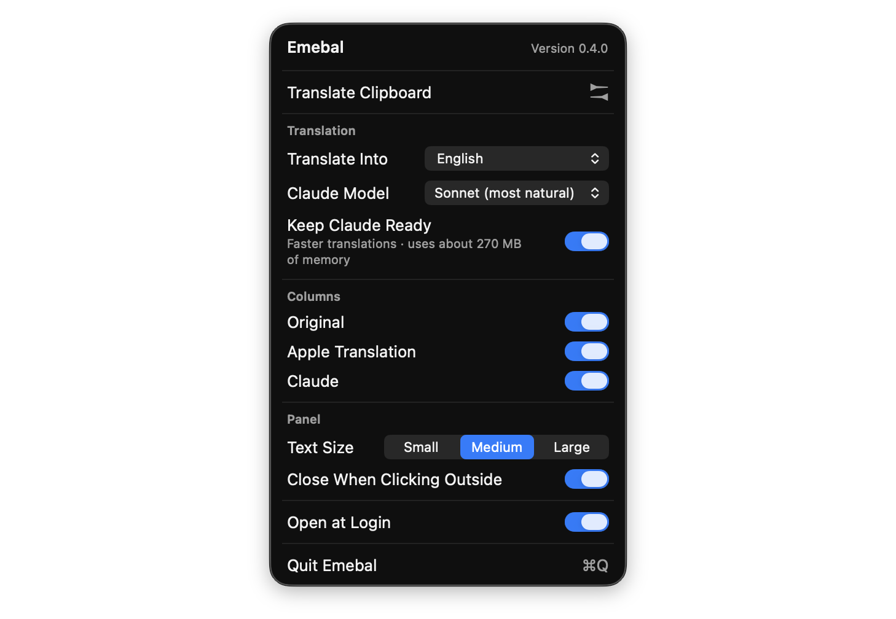

<p align="center">
  
</p>

<p align="center">
  <strong>テキストを選んで、⌘ を押したまま C を2回。あなたの言語で読めます。</strong>
</p>

<p align="center">
  <a href="https://github.com/ArnaudDerosin/emebal/releases/latest"></a>
  
  
  <a href="LICENSE"></a>
  
</p>

<p align="center">
  <a href="README.md">English</a> · <strong>日本語</strong>
</p>

<p align="center">
  <a href="#実際の動き">実際の動き</a> ·
  <a href="#機能">機能</a> ·
  <a href="#しくみ">しくみ</a> ·
  <a href="#はじめかた">はじめかた</a> ·
  <a href="#emebal-という名前">名前の由来</a>
</p>

---

Emebal は、Mac のメニューバーで動く、ミニマルで速い翻訳アプリです。どのアプリでもテキストを選んで、**⌘** を押したまま **C** を2回（**⌘C C**）押すと、その場にすっきりしたパネルが開き、Apple の**すぐに出る**翻訳と、Claude の**自然な**翻訳が横に並びます。

ウィンドウを切り替えることも、ウェブサイトに貼り付けることもありません。選んで、押して、読むだけです。

<p align="center">
  
</p>

## 実際の動き

どのアプリでもテキストを選んで、⌘ を押したまま C を2回。作業している場所に、小さなパネルがひとつ開くだけです。

<table>
  <tr>
    <td width="50%" valign="top">
      <br />
      <b>横に並べて翻訳</b><br />
      Apple のオンデバイス翻訳がすぐに表示され、その横に Claude の自然な翻訳が、元のトーンのまま届きます。
    </td>
    <td width="50%" valign="top">
      <br />
      <b>Claude の訳を 1 秒以内に</b><br />
      必要な列だけを表示できます。Claude を待機させておく をオンにすると、Claude の最初の言葉が 1 秒以内に表示されます。
    </td>
  </tr>
  <tr>
    <td width="50%" valign="top">
      <br />
      <b>文章を改善</b><br />
      自分の下書きを選んで 改善 をクリック。Claude が同じ言語のまま、より明確で自然な文章に書き直し、その翻訳もすぐ下に表示します。
    </td>
    <td width="50%" valign="top">
      <br />
      <b>好みに合わせて</b><br />
      翻訳先の言語、Claude のモデル、表示する列、文字サイズを、すべてメニューバーから変更できます。
    </td>
  </tr>
</table>

## 機能

- **すぐに出る。** Apple のオンデバイス翻訳がすぐに表示されます。オフラインで、無料です。
- **自然な訳。** 続いて Claude の翻訳が届きます。流れるような訳で元のトーンを保ち、コード、ファイルパス、URL はそのまま残します。
- **速い。** Claude の翻訳は書かれたそばから表示され、最初の言葉は約 1.5 秒で出ます。**Claude を待機させておく** をオンにすると約 0.9 秒になります（Claude Code を起動したままにし、約 270 MB のメモリを使います）。
- **文章を改善。** 自分の下書きで、原文の下の **改善** をクリックすると、Claude が同じ言語のまま書き直した、より明確で自然な文章と、その翻訳が、下の新しい行に表示されます。コードや URL はそのまま残します。
- **じゃまにならない。** カーソルの近くに静かに開き、外側をクリックすると閉じるパネル。Dock アイコンもメインウィンドウもありません。
- **自動。** 翻訳元の言語を Mac 上で判別します。コードだらけの技術的なメッセージでも正しく判別できます。
- **好みに合わせて。** 翻訳先の言語、文字サイズ、表示する列（原文、Apple、Claude）、Claude のモデルを、シンプルなメニューから変更できます。
- **Claude の使用状況もひと目で。** セッションと週の使用率、セッションがリセットされるまでの時間を表示します。
- **英語と日本語に対応**。Mac の言語設定に合わせて表示されます。ほかに、メニューバーからのクリップボードの翻訳、ログイン時に開く にも対応しています。

## しくみ

| | Apple の翻訳 | Claude |
|---|---|---|
| 速さ | すぐに表示 | 最初の言葉まで約 1.5 秒（Claude を待機させておく場合は約 0.9 秒） |
| 動作場所 | Mac 上（オフライン） | お使いの Claude Code 経由 |
| 費用 | 無料 | ご自身の Claude アカウントの使用量に含まれます |
| 訳し方 | 直訳寄り | 自然で、元のトーンを保ち、コードはそのまま |

- **Apple の翻訳** は macOS に組み込まれていて、Mac 上で動作し、無料です。初回のみ、システム設定で言語のダウンロードが必要な場合があります。
- **Claude** の翻訳は、Mac にインストールされている [Claude Code](https://claude.com/claude-code)（Anthropic の `claude` コマンドラインツール。Claude のデスクトップアプリではありません）を使います。Emebal があなたの認証情報に触れることはありません。Claude Code がご自身のサインインを使い、使用量はご自身の Claude プランに含まれます。Claude は元のトーンを保ち、コード、識別子、ファイルパス、URL をそのまま残すので、コードレビューや技術的なやりとりにも便利です。

## はじめかた

### 必要なもの

- macOS 15 以降
- ソースからビルドするための Xcode 16 以降（Swift 6）
- Claude の翻訳を使う場合（任意）：[Claude Code](https://claude.com/claude-code)（`claude` コマンドラインツール。Claude のデスクトップアプリではありません）をインストールし、Claude アカウントでサインインしておくこと（下記参照）

### Claude の設定（任意）

Apple の翻訳は設定なしで使えます。Claude の翻訳を使うには、[Claude Code](https://claude.com/claude-code) をインストールして、Claude アカウントで一度サインインしてください。API キーは必要ありません。

<details>
<summary>設定の手順を表示</summary>

<br>

1. Claude Code をインストールします。

   ```sh
   curl -fsSL https://claude.ai/install.sh | bash
   ```

   ほかのインストール方法（Homebrew、npm）は[Claude Code のドキュメント](https://code.claude.com/docs/en/setup)にあります。

2. ターミナルで `claude` を実行し、Claude アカウントでサインインします（サブスクリプションではなく Anthropic Console の従量課金を使っている場合は、API キーでも使えます）。

3. 動作を確認します。

   ```sh
   claude -p "Say hello"
   ```

これで完了です。Emebal は `claude` を自動で見つけ、あなたのサインインを使います。認証情報に触れることはなく、使用量はご自身の Claude プランに含まれます。Claude Code がない場合やサインインしていない場合は、Claude の列にその旨と解決用のボタンが表示され、Apple の翻訳はそのまま使えます。メニューで Claude をオフにすることもできます。

</details>

### インストール

**ダウンロード：** [最新のリリース](https://github.com/ArnaudDerosin/emebal/releases/latest)から `Emebal-x.y.z.zip` をダウンロードして展開し、**Emebal** をアプリケーションフォルダに移動します。Emebal はまだ Apple の公証を受けていないため、初回は macOS が開くのをブロックします。**システム設定 → プライバシーとセキュリティ** で **このまま開く** をクリックしてください。

**ソースからビルドする場合：**

```sh
git clone https://github.com/ArnaudDerosin/emebal.git
cd emebal
./scripts/build-app.sh --install
```

Emebal をビルドして `/Applications` に移動し、起動します。Emebal は Dock ではなく、メニューバー（吹き出しのアイコン）に表示されます。自動で起動させるには、メニューの **ログイン時に開く** をオンにしてください。

アップデートするには、最新の変更を取得して同じコマンドをもう一度実行します。そのあと、**システム設定 → プライバシーとセキュリティ → アクセシビリティ** で Emebal を **−** で削除してから、もう一度許可してください。ビルドのたびに署名が変わるため、スイッチがオンのままでも、macOS は以前の許可を新しいビルドに適用しません。

コードを編集する場合は、フォルダを Xcode で開くか（`open Package.swift`）、`swift build` を実行してください。`--install` を付けずに `./scripts/build-app.sh` を実行すると、`build/Emebal.app` のビルドだけを行います。

### アンインストール

1. メニューバーのアイコンのメニューで、**ログイン時に開く** がオンならオフにしてから、**Emebal を終了** を選びます。
2. アプリケーションフォルダの **Emebal** をゴミ箱に入れます。
3. 必要に応じて、残っている項目も削除します。
   - **システム設定 → プライバシーとセキュリティ → アクセシビリティ** の Emebal（選択して **−** をクリック）
   - 設定ファイル：`defaults delete io.github.arnaudderosin.emebal`

### アクセシビリティの許可

初めて使うときに、**システム設定 → プライバシーとセキュリティ → アクセシビリティ** で Emebal を許可するよう求められます。⌘C C のショートカットを検知するために必要です。許可しなくても、メニューバーのアイコンから**クリップボードを翻訳** は使えます。

<details>
<summary>再ビルド後に許可が効かなくなった場合</summary>

<br>

macOS はアクセシビリティの許可をアプリの署名に結びつけています。標準ではアドホック署名でビルドされ、署名はビルドのたびに変わります。いったん解決するには、次を実行します。

```sh
tccutil reset Accessibility io.github.arnaudderosin.emebal
```

そのあと、アプリをもう一度開いて許可してください。再ビルドしても許可が保たれるようにするには、自己署名のコード署名証明書を作成し（キーチェーンアクセス →証明書アシスタント → 証明書を作成…、固有名の種類 **自己署名ルート**、証明書のタイプ **コード署名**）、その証明書でビルドします。

```sh
EMEBAL_SIGN_IDENTITY="Emebal Local Signing" ./scripts/build-app.sh --install
```

</details>

### テスト

```sh
swift test                        # 高速なテストのみ
EMEBAL_LIVE_TESTS=1 swift test    # Claude Code で実際の翻訳も実行
```

### リリース

ユーザーに伝えたい変更は、変更するたびに [CHANGELOG.md](CHANGELOG.md) の `## [Unreleased]` の下に書いておきます。バージョンを公開するには：

```sh
./scripts/release.sh 0.2.0
```

`main` に未コミットの変更がなく最新であること、テストが通ることを確認し、バージョンの設定、変更履歴への日付の追加、アプリのビルドと zip 化を行います。確認のあと、`v0.2.0` のタグを付けて、変更履歴の内容と zip を添えた [GitHub リリース](https://github.com/ArnaudDerosin/emebal/releases)を公開します。バージョンは[セマンティック バージョニング](https://semver.org/lang/ja/)に従います（新機能は `0.2.0`、修正は `0.1.1`）。

### 翻訳（ローカライズ）

Emebal の表示言語は macOS の言語設定に従い、対応していない言語では英語で表示されます。各言語は `Resources/Localization/` 内のフォルダ（`en.lproj`、`ja.lproj`…）で、`Localizable.strings` ファイルを含みます。キーは英語のテキスト、値がその翻訳です。

言語を追加するには（例：フランス語）：

1. `ja.lproj` を `fr.lproj` としてコピーし、各値を翻訳します。`%@` などのプレースホルダーは残してください。語順が変わる場合は `%1$@`、`%2$@` と書きます。
2. `swift test` を実行します。すべての言語に英語の文字列がそろっていて、プレースホルダーが一致しているかを確認します。

コード内の表示テキストを変更したら、`./scripts/update-strings.sh` を実行してください。コードから英語の文字列を作り直し、各言語に足りない文字列を表示します。

## Emebal という名前

名前はシュメール語の **eme-bal**（𒅴𒁄）に由来します。「通訳者」を意味し、直訳すると *「舌を返す者」* です。

| 文字 | 読み | 意味 |
|---|---|---|
| 𒅴 | *eme* | 「舌」。「口」の文字の中に ME を書いたもの |
| 𒁄 | *bal* | 「回す、渡る」 |

翻訳者を表す、知られている中で最も古い言葉のひとつで、この称号を持つ通訳者は4,000 年以上前のメソポタミアの記録に登場します。アイコンの2つのくさびは楔形文字の基本の線で、互いに反対を向いています。ひとつの言語が、もうひとつの言語に変わる様子です。

## ライセンス

[MIT](LICENSE)

Emebal は個人のプロジェクトであり、Anthropic や Apple とは提携しておらず、承認を受けたものでもありません。
